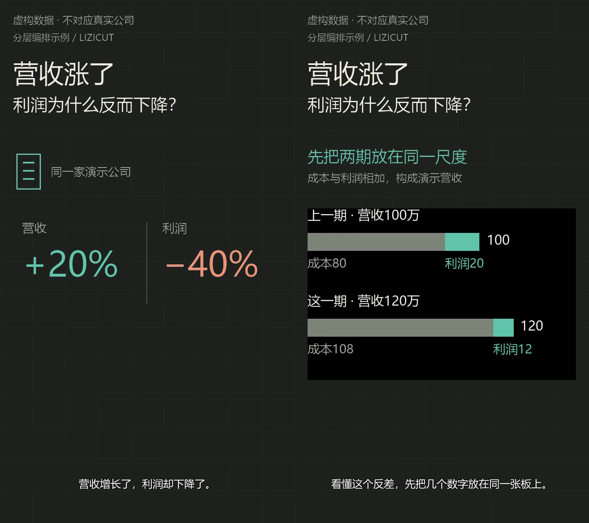

# 竖屏分层示例

这是一段 9.36 秒、720×1280、25 fps 的可重建示例，复用营收/利润例子的两句合成旁白，不是真人原声或真实公司材料。背景、前景元素和模板在时间线上分别编排。



- [成片](film.mp4)、[时间线](timeline.json)和[字幕](captions.srt)保留在本目录。
- 2 秒原创网格背景循环覆盖 9.36 秒；标题和虚构数据标识持续保留。
- 0.24 秒进入透明主体标记与对照板，3.60 秒共同退出；两组数字在第一句内可见。
- 3.60 秒进入为竖屏重新排版的视频板面与说明，主背景继续循环。视频板面从源文件 1.60 秒开始，演示不同源入点与叠层时间。
- 配乐使用原创低电平测试音，只验证循环、平滑降低和恢复，不作为正式选曲样本。旁白、BGM 与字幕遵循同一成片时间。

引用的旁白位于相邻的 `../revenue-profit/assets/`，应保留完整示例目录。所有数据均为虚构，来源用途标为 illustration；不把生成素材包装成事实证据。

重建使用已经提供的素材与本地字体，不调用新配音或在线服务：

```text
python scripts/make_layered_demo.py --overwrite
python skills/lizicut/scripts/lizicut.py validate examples/layered-edit/timeline.json --media
python skills/lizicut/scripts/lizicut.py inspect examples/layered-edit/film.mp4 --decode
```

本例验证分层执行与竖屏重排，不等同于真实主播粗剪、网络取证、语音识别或独立人工审片。原声保护另有带实际音频流的媒体集成测试。
