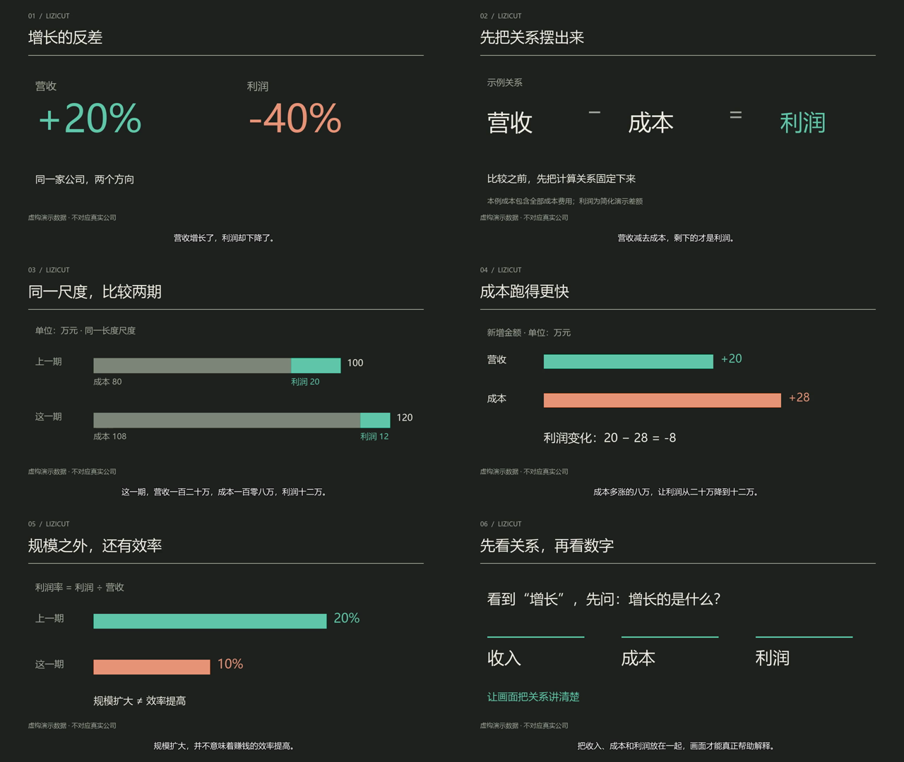

# 完整示例：营收增长，为什么利润反而下降？

这是本 Skill 的作者自检示例。数字全部虚构，不对应真实公司；旁白使用本机已安装的中文 SAPI 语音，不是真实人物原声。没有调用网络模型或付费服务。



## 输入与实际结果

- [原稿](script.json)：6 个解释单元、12 句旁白。
- [数据](data.json)：上一期收入 100、成本 80、利润 20；这一期收入 120、成本 108、利润 12，单位为万元。
- [字幕](captions.srt)：按每句实际生成的音频时长编排，非词级 ASR 或强制对齐结果。
- [时间线](timeline.json)：同时保留素材来源、画面任务、剪辑理由和源/成片时间。
- [成片](film.mp4)：63.00 秒，1280×720，25 fps，1575 帧，H.264 + AAC。
- `assets/`：12 个句段 WAV 和 6 个带分步揭示的解释画面视频。

## 剪辑选择

| 成片区间 | 观众要看懂什么 | 实际选择及理由 |
|---|---|---|
| 00:00—00:09.36 | 营收和利润可以向相反方向变化 | 同板对照 +20% 与 -40%；没有用泛化上涨素材代替关系 |
| 00:09.36—00:18.64 | 收入、成本与利润的计算关系 | 逐步揭示营收−成本=利润，先固定解释骨架 |
| 00:18.64—00:31.48 | 两期结构有何变化 | 同一尺度堆叠成本与利润；第二期按对应句段出现，第一期保留 |
| 00:31.48—00:41.76 | 利润为何减少 | 比较收入增量 20 与成本增量 28，落到利润变化 -8 |
| 00:41.76—00:51.60 | 扩张与效率不是同一件事 | 显示 20% 与 10% 利润率，条长比例一致 |
| 00:51.60—01:03.00 | 带走什么判断方法 | 减少新信息，回到收入、成本、利润的关系并收束 |

6 个镜头承载 12 句口播，体现“解释单元可以跨句”；没有为了匹配旧纯画面配额插入无关 B-roll。模板文字提炼关系与数值，底部字幕保留完整旁白。为便于听清概念，本例使用旁白而不硬加背景音乐；BGM、ducking、fade 与多轨混音另有真实媒体集成测试。

本例把全部成本费用合并为“成本”，利润为简化演示差额，并非完整财报会计定义。第一句同时谈到营收与利润，因此 v0.1.1 已改成同句内准备完整对照，不再等第二句才揭示利润下降；只有句级时间，不宣称词级卡点。

## 重建

在项目根目录，复用已有 WAV 与画面：

```text
python skills/lizicut/scripts/lizicut.py validate examples/revenue-profit/timeline.json --media
python skills/lizicut/scripts/lizicut.py render examples/revenue-profit/timeline.json --output output/revenue-profit.mp4
python skills/lizicut/scripts/lizicut.py inspect output/revenue-profit.mp4 --decode
```

修改原稿或数据后，更新相应旁白，再重建画面、字幕与时间线：

```text
python scripts/make_demo.py --refresh-voice --rebuild-visuals --render --overwrite
```

`make_demo.py` 的配音重建只适用于已安装中文语音的 Windows 账户，直接调用系统 SAPI，不修改 PowerShell 执行策略、注册表或权限。受限账户看得到语音名称但无法访问语音引擎时，复用已提供的 WAV，或在拥有该语音的本地账户执行。其他平台可以复用提供的素材，用已有字体与工具制作替换镜头。

默认字体来自本机 `Microsoft YaHei`，系统字体文件没有放入项目。重建视觉时可通过 `--font` 指定已有中文字体；换平台后同时调整 timeline 中的字幕字体名称并检查实帧。不要在数据变化后沿用旧配音；脚本不能代替语义校对。

## 已检查与边界

本例已完成实际编码、全片解码、时长/帧数/尺寸/音轨检查，六个关键状态已做作者视觉自检；虚构数据的等式、变化量、百分比和条长已核对。没有取得独立人工审片，也没有验证真实新闻素材、外部 ASR、付费生成或原站数据库配置。
